<div align="center">
  

  <br /><br />

  [](https://developer.mozilla.org/en-US/docs/Web/API/Canvas_API)
  [](https://developer.mozilla.org/en-US/docs/Web/JavaScript)
  [](https://vitejs.dev/)
  [](#mekanik-pertarungan)
  [](#daftar-10-petarung-roster)

  <p align="center">
    <a href="#tentang-proyek">Tentang Proyek</a> •
    <a href="#mekanik-pertarungan">Mekanik Pertarungan</a> •
    <a href="#daftar-10-petarung-roster">10 Roster Legenda</a> •
    <a href="#kontrol-permainan">Kontrol</a> •
    <a href="#cara-menjalankan">Cara Menjalankan</a>
  </p>
</div>

---

## Tentang Proyek

**Ragnarok: Stickman Tag Combat** adalah game pertarungan arcade 2D berbasis **HTML5 Canvas** dengan sistem **2v2 Tag-Team**. Pemain membentuk tim berisi 2 petarung (*Point* & *Anchor/Partner*) dari jajaran **10 tokoh sejarah, pendekar, dan kreator legendaris** untuk bertarung dalam duel berkecepatan tinggi dengan efek neon dinamis, *hitstop*, *screen shake*, dan serangan pemungkas *X-Ray*.

---

## Mekanik Pertarungan

| Mekanik | Deskripsi Gameplay |
| :--- | :--- |
| **2v2 Tag-Team & Red Life** | Tukar petarung di tengah kombo (`Tag Switch`) untuk menjaga tekanan serangan. Petarung di bangku cadangan (*Bench*) memulihkan sebagian **Red Life** secara otomatis. |
| **Tag Counter (Reversal)** | Saat terpojok dalam posisi bertahan (*Block*), korbankan **1 Bar Team Meter** untuk memanggil partner masuk menerjang lawan dan memutus kombo musuh. |
| **4-Hit Mixup & X-Ray** | Rangkai variasi *Punch* dan *Kick* hingga serangan ke-4 yang memicu visual tulang **X-Ray**, *hitstop* dramatis, dan kerusakan besar. |
| **3 Mode Permainan** | **1P Tag Arcade** (VS AI Bot `EASY` / `NORMAL` / `HARD`), **2P Local Versus** (1 keyboard berdua), dan **Training Lab** lengkap dengan *Hitbox/Hurtbox Viewer* (`F1`). |

---

## Daftar 10 Petarung (Roster)

| # | Petarung | Gaya Bertarung (*Archetype*) | Skill 1 (*Signature*) | Skill 2 (*Ultimate*) |
| :---: | :--- | :--- | :--- | :--- |
| 1 | **Thomas Alva Edison** | Tactical Zoner | Menlo Voltage Orb | Physics Dagger Blitz |
| 2 | **Nikola Tesla** | Lightning Duelist | Alternating Arc | Lightning Slash Stun |
| 3 | **Masashi Kishimoto** | Agile Trickster | Ink Shadow Slash | Spiral Wind Orb |
| 4 | **Bruce Lee** | Rushdown Striker | One-Inch Dragon | Dragon Stun Kick |
| 5 | **Muhammad Ali** | Critical Boxer | Critical Punch | Double Critical Punch |
| 6 | **Sasaki Kojiro** | Twin-Katana Tempest | Tempest Tornado | Double Slash Sword |
| 7 | **Okita Souji** | Demon-Blade Striker | Cut Slash Demon | Flying Demon Slash |
| 8 | **Raiden Tameemon** | Sumo Juggernaut | Shiko Stomp | Suriashi Charge |
| 9 | **Napoleon Bonaparte** | Cavalry Duelist | Switch Sword (*Saber/Epée*) | Imperial Warhorse Charge (*4s Mount*) |
| 10 | **Jack the Ripper** | Victorian Steampunk Assassin | Single Ripper Throw | Divine Gauntlet: Triple Blades |

---

## Kontrol Permainan

| Aksi | Player 1 | Player 2 |
| :--- | :---: | :---: |
| **Gerak & Lompat** | `W` `A` `D` | `↑` `←` `→` |
| **Bertahan (Block)** | Tahan `S` | Tahan `↓` |
| **Dash / Evasive Roll** | `Q` / `X` | `M` / `N` |
| **Punch / Kick (4-Hit Combo)** | `F` / `R` | `K` / `.` |
| **Skill 1 / Skill 2** | `G` / `T` | `L` / `/` |
| **Tag Switch (Ganti Partner)** | `E` | `,` (Koma) |
| **Tag Counter (Saat Block, 1 Bar)** | `S` + `E` | `↓` + `,` |
| **Move List / Hitbox Viewer** | `TAB` / `F1` | `TAB` / `F1` |

> **Shortcut Training Lab:** Tekan `F1` untuk menampilkan *Hitbox/Hurtbox*, `F2` untuk reset posisi & HP, dan `F3` untuk mengganti perilaku AI Dummy.

---

## Arsitektur & Teknologi

* **Rendering Engine:** HTML5 2D Canvas API dengan custom *particle emitter*, *afterimage trail*, dan *camera shake*.
* **Combat Logic:** Finite State Machine (FSM) untuk transisi *Idle, Walk, Jump, Attack Frames (Startup/Active/Recovery), Hitstun, Blockstun,* dan *Tag Assist*.
* **Collision System:** Deteksi tabrakan *AABB (Axis-Aligned Bounding Box)* terpisah untuk *Hurtbox* dan *Hitbox*.
* **Build Tool:** Vite + Vanilla JavaScript (ES6+).

---

## Cara Menjalankan

1. **Clone repositori ini:**
   ```bash
   git clone [https://github.com/lutfifr31/ragnarok-stickman-combat.git](https://github.com/lutfifr31/ragnarok-stickman-combat.git)
   cd ragnarok-stickman-combat